<p align="center">
  
</p>

<p align="center">
  
</p>

<p align="center">
  
</p>

<table>
  <tr>
    <td width="35%" align="center" valign="middle">
      
    </td>
    <td width="65%" valign="middle">

```yaml
identity: "Resha Meiranadi Caturkusuma"
role: "Laboran & Asisten Dosen @ Universitas Dian Nuswantoro Kediri"
education: "Bachellor's Degree (S1) Student"
passions: ["Data Science", "Web Development", "Content Creation"]
location: "Kediri, Indonesia 🇮🇩"
bio: "Tempat seru-seruan buat eksplorasi coding dan ide-ide baru."
```

</td>
  </tr>
</table>

> 💡 *Most of my projects are private (campus and client work), so this profile is more about what I like building than a showcase.*

<p align="center">
  
</p>

<p align="center">
  <a href="https://skillicons.dev">
    
  </a>
</p>

<p align="center">
  
  &nbsp;
  
</p>

<p align="center">
  
</p>

> 📌 **What I'm currently working on:**
> - 🎓 Studi magister (S2) & bahan ajar praktikum kampus
> - 🌐 Pengembangan aplikasi web untuk kampus & komunitas
> - 🎥 Eksperimen konten kreatif seputar tech & data

<p align="center">
  
</p>

<p align="center">
  <a href="https://instagram.com/reshameir" target="_blank">
    
  </a>
  &nbsp;
  <a href="https://linkedin.com/in/resha-meiranadi-caturkusuma" target="_blank">
    
  </a>
  &nbsp;
  <a href="mailto:reshameiranadi@gmail.com">
    
  </a>
</p>
